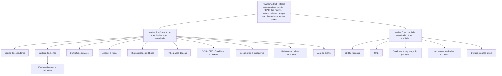

# CCIH Integra — Dois modelos de negócio: auditoria e plano

Data: 13/10/2026. Situação: **Fases 1 e 2 (auditoria e plano). Nenhuma alteração de código ou de banco foi feita nesta etapa.**

Modelos:
- **A — Consultorias**: empresas e profissionais que prestam consultoria em CCIH, CME, qualidade e segurança do paciente a vários clientes.
- **B — Hospitalar**: o sistema atual, de operação interna do estabelecimento, preservado integralmente.

---

## Fase 1 — Auditoria do projeto

### 1.1 Tecnologia e organização do repositório

| Camada | O que existe (verificado no código) |
| --- | --- |
| Monorepo | npm workspaces: `packages/domain` (regras de negócio puras, TypeScript), `packages/demo-data` (dados sintéticos), `packages/ui` (design system React), `apps/web`, `apps/api`; `e2e/` (Playwright) |
| Front-end | React 18, React Router 7, TanStack Query, Vite. Contrato único de dados `CcihDataSource` (`apps/web/src/data/port.ts`) com duas implementações: `ApiDataSource` (produção) e `DemoDataSource` (só painel e indicadores, sem backend). Tema claro/escuro, foco visível, contraste verificado, layout responsivo |
| API | Fastify 5, zod em toda entrada, Kysely (SQL tipado, sem ORM pesado), 156 rotas em 17 arquivos (`apps/api/src/routes`) |
| Banco | PostgreSQL 16, 11 migrações estáticas (`apps/api/src/db/migrate.ts`), 72 tabelas, dois papéis de banco (dono das migrações × aplicação só com DML), tabelas de histórico somente inserção (gatilho `append_only()` e `REVOKE UPDATE/DELETE`), `audit_log` encadeado por hash |
| Autenticação | Sessão em cookie `HttpOnly`, CSRF por token + verificação de origem, bloqueio por tentativas, limite por IP, troca obrigatória de senha temporária, política de senha, expiração por inatividade e absoluta |
| Autorização | RBAC no servidor: 52 permissões `modulo:acao`, 14 perfis (9 funções + 4 adicionais + administrador), concessões individuais com validade, escopo por setor, conta criadora única por instituição, gestão de usuários por módulo, Jovem Aprendiz por marcadores |
| Tempo real | Outbox na mesma transação + `pg_notify` + SSE com filtro por permissão, setor e usuário; modo periódico alternativo |
| Testes | domínio 111, dados sintéticos 13, UI 14, API 126 (+1 só com ClamAV real), web 61, E2E 10 — todos verdes no último commit |
| Scripts | `npm run check` (lint, tipos, testes), `build`, `db:reset`, `admin:bootstrap`, `attachments`, `test:e2e` |
| Variáveis | `apps/api/.env.example` documenta banco, sessão, cifragem de nomes e de anexos, armazenamento, antivírus e tempo real; nenhuma credencial versionada |

### 1.2 Organização ("tenant") e usuários hoje

- A organização já existe e se chama **`institution`** (nome, CNES, fuso, origem dos dados). **Todas as 72 tabelas** pertencem a uma instituição: 62 têm `institution_id` próprio; as demais são filhas (histórico de status, itens de bundle, planos 5W2H, presença em treinamento, antibiograma…) e herdam a instituição pelo registro-pai.
- `app_user.institution_id` liga cada usuário a **uma** instituição. O **login é único em toda a plataforma**, então o login já identifica a organização: não há seletor de organização na entrada, e a organização da sessão nunca vem do navegador.
- Toda rota usa `auth.institutionId` da sessão; o front-end não envia o identificador da organização.
- **Não existe criação de organização**: a instituição só é criada pelo seed de demonstração. A conta criadora é criada por comando no servidor (`admin:bootstrap`) para uma instituição já existente.
- **Não há Row-Level Security** no banco: o isolamento é feito na aplicação.
- Os testes usam **uma única instituição**: não existe teste automatizado de acesso cruzado entre organizações.

### 1.3 Módulos existentes (modelo hospitalar)

| Área | Situação | Onde |
| --- | --- | --- |
| Painel executivo e indicadores (motor único, fórmulas e metas configuráveis) | Implementado | `domain/indicators`, `/`, `/indicadores` |
| Pacientes, internações, dispositivos, censo diário (nome cifrado) | Implementado | `routes/patients.ts`, `/pacientes`, `/censo` |
| Vigilância de IRAS (suspeita → investigação → confirmação/descarte, critério versionado) | Implementado | `routes/iras.ts`, `/vigilancia` |
| Cirurgias, ISC, microbiologia, antibiograma | Implementado | `routes/surgery-micro.ts` |
| Bundles configuráveis e higiene das mãos | Implementado | `routes/quality.ts`, `/bundles` |
| Auditorias, não conformidades, planos 5W2H, verificação de eficácia | Implementado (auditoria ligada a setor do hospital) | `routes/quality.ts`, `/auditorias` |
| Treinamentos (presença, cobertura, vencimentos) e insumos (lotes) | Implementado | `routes/training-supplies.ts` |
| Central de alertas (ciclo de ações, bloqueio, exceção) e notificações pessoais | Implementado | `routes/alerts.ts`, `notifications.ts` |
| CME completa (ciclos, testes, liberação por política, estações de leitura, processos, rastreabilidade até o paciente, etiquetas Code 128/ZPL) | Implementado | `routes/cme*.ts` |
| Anexos (antivírus, cifragem, S3) | Implementado | `routes/attachments.ts` |
| Usuários, funções, permissões, log de auditoria | Implementado | `routes/users.ts`, `admin.ts` |
| Configuração (metas, parâmetros, referências, setores, política da CME) | Implementado | `routes/config.ts`, `org.ts` |
| Stewardship de antimicrobianos | **Ausente** (menu mostra "Fase 6", sem tela falsa) | — |
| Relatórios (PDF/CSV/XLSX) | **Ausente** (menu mostra "Fase 7") | — |
| Gestão de documentos (versionamento, aprovação, validade) | **Ausente** (existem só anexos de evidência) | — |
| Plano da CME pendente (integração E1, correção de ciclo H1, importação H2, parâmetros governados I1, nuvem G2, validação I2) | Pausado | `docs/cme-integracao` |

### 1.4 O que pode ser reaproveitado no modelo de consultorias

| Existente | Reuso no modelo A |
| --- | --- |
| `institution` + sessão + RBAC + escopo + concessões | Base do isolamento por organização e por função; o escopo por **setor** inspira o escopo por **cliente** |
| Auditorias, NC, 5W2H, eficácia (`quality_audit`, `nonconformity`, `action_plan`) | Fluxo de achados e planos — precisa de cliente/estabelecimento, responsável do cliente, evidência e validação de encerramento |
| Modelos de bundle versionados | Padrão para checklists de diagnóstico e auditoria versionados |
| Motor de indicadores, catálogo, fórmulas e metas | Indicadores de IRAS e CME por cliente a partir de **dados agregados** (numeradores/denominadores), sem inventar fórmulas |
| Anexos (antivírus, cifragem) | Evidências, documentos e entregáveis |
| Alertas e notificações | Prazos, vencimentos de contrato e atrasos |
| Tempo real, log de auditoria encadeado, histórico somente inserção | Rastreabilidade de quem fez o quê |
| Design system, tema, acessibilidade, `DataTable`, formulários | Telas do modelo A com a mesma identidade |

### 1.5 Riscos de regressão

1. **Vazamento entre organizações**: o filtro por `institution_id` é feito à mão em cada consulta. A revisão encontrou o padrão "busca com instituição, depois altera pelo id", correto, mas **sem teste de acesso cruzado**: um único filtro esquecido numa rota nova vazaria dados. Com várias organizações reais, este passa a ser o risco número 1.
2. **Permissões**: perfis e permissões são globais (não distinguem modelo). Sem um corte por modelo, um perfil hospitalar poderia ser atribuído numa consultoria.
3. **Navegação**: o menu é filtrado só por permissão; precisa considerar também o modelo.
4. **Seed e testes** assumem uma instituição; a mudança não pode alterar os dados de demonstração existentes nem os 325 testes atuais.
5. **Nomenclatura**: "instituição" aparece em telas e documentos com sentido de hospital; numa consultoria "instituição" passa a ser a própria consultoria, e os hospitais são **clientes**.

### 1.6 Proposta arquitetural (resumo)

Reutilizar `institution` como a **organização** da plataforma e acrescentar o **tipo de organização** (`organization_type`: `hospitalar` | `consultoria`). Todas as instituições existentes passam a `hospitalar` sem perder nada. O modelo da organização corta, no servidor, as permissões e os módulos disponíveis. O modelo de consultorias ganha tabelas próprias para clientes, estabelecimentos, contratos, equipe, agenda, avaliações, documentos e relatórios, e reaproveita auditoria, NC, 5W2H, indicadores, anexos e alertas, ampliados de forma compatível.

---

## Fase 2 — Planejamento da arquitetura

### 2.1 Diagrama dos dois modelos



### 2.2 Módulos compartilhados e exclusivos

| Componente | Hospitalar | Consultoria |
| --- | --- | --- |
| Autenticação, sessão, conta criadora, usuários, log de auditoria, notificações, alertas, anexos, tempo real | ✔ | ✔ |
| Motor e catálogo de indicadores (fórmulas, metas) | ✔ (dados operacionais) | ✔ (dados agregados por cliente) |
| Auditoria → NC → 5W2H → eficácia | ✔ (setores do hospital) | ✔ (cliente/estabelecimento, responsável do cliente) |
| Checklists versionados | Bundles | Diagnósticos e auditorias |
| Pacientes, IRAS caso a caso, cirurgias, microbiologia, censo, CME operacional, estações, etiquetas, insumos | ✔ | — (a consultoria não executa a CME nem a vigilância do cliente) |
| Carteira de clientes, estabelecimentos, contratos, equipe e carteiras, agenda, diagnóstico, documentos versionados, relatórios consolidados, área do cliente | — | ✔ |
| Documentos versionados com aprovação | Previsto para depois (o hospital também precisa; o módulo será compartilhável) | ✔ |

### 2.3 Modelo de dados proposto

**Fundação (migração 0012):**
- `institution.organization_type` — `hospitalar` | `consultoria`, `NOT NULL DEFAULT 'hospitalar'`. Todas as instituições atuais ficam `hospitalar`. Um gatilho impede a troca por `UPDATE` comum; a conversão só acontece por comando administrativo (ver 2.6).
- `institution`: campos institucionais opcionais (razão social, CNPJ), sem alterar os atuais.
- `role.organization_types` — em quais modelos cada perfil pode ser atribuído (os 14 perfis atuais: só `hospitalar`, exceto Administrador, que vale nos dois).

**Modelo A (migrações 0013+, aditivas, todas com `institution_id` = a consultoria):**

| Tabela | Conteúdo |
| --- | --- |
| `client` | Cliente da carteira: razão social, nome fantasia, CNPJ, tipo de estabelecimento, situação do relacionamento, consultor responsável, observações internas |
| `client_contact` | Responsáveis técnicos e administrativos e contatos autorizados |
| `client_establishment` | Estabelecimentos do cliente (endereço, CNES, tipo, nº de leitos/setores) e suas unidades/setores (`client_unit`) |
| `client_assignment` | Consultor ↔ cliente, papel, início e fim (troca de responsável sem perder histórico; somente inserção para encerramentos) |
| `contract`, `contract_service`, `contract_amendment` | Contratos/propostas, serviços e escopo, vigência, frequência de visitas, horas/entregas previstas, renovação, aditivos (histórico preservado). Dados financeiros em colunas protegidas por permissão própria; sem integração simulada |
| `consulting_activity` | Agenda: visita, reunião, auditoria, inspeção, treinamento, avaliação, entrega de relatório, acompanhamento de plano; cliente, estabelecimento, responsável, data, duração, objetivo, conclusão, pendências |
| `checklist_template`, `checklist_template_version`, `checklist_item` | Checklists versionados por domínio (CCIH, CME, qualidade, segurança do paciente, documentação…), com critério, peso e **referência** (sem declarar conformidade normativa sem evidência) |
| `assessment`, `assessment_answer` | Diagnóstico situacional e auditorias: tipo (inicial, periódica, auditoria), separação entre conformidade legal, institucional e maturidade, pontuação por domínio, achados, evidências, amostragem |
| `nonconformity` (ampliada) | + `client_id`, `establishment_id`, `assessment_id`, risco, contenção, causa (5 Porquês, Ishikawa), responsável do cliente, evidência de implementação, validação de eficácia (quem validou) |
| `action_plan` (ampliada) | + responsável (usuário do cliente ou nome), evidência, conclusão validada |
| `client_indicator_value` | Numerador/denominador mensais por cliente, estabelecimento, unidade e indicador do catálogo (ex.: IPCS, PAV, ISC, densidade de uso de dispositivo, indicadores da CME), com origem e quem informou. **Sem dados de pacientes** |
| `document`, `document_version` | Repositório por organização/cliente/estabelecimento/categoria; versões imutáveis; emissão, validade, autor, responsável técnico, revisão e aprovação; modelos da consultoria separados dos documentos do cliente (uma versão aprovada nunca muda quando o modelo muda) |
| `consulting_training`, `consulting_training_session`, `consulting_training_attendance` | Treinamentos por cliente (público, instrutor, material, presença, avaliação) |
| `report`, `report_version` | Relatórios gerados (conteúdo congelado na emissão), liberação ao cliente |
| `release` (coluna `released_to_client_at` nas tabelas pertinentes) | O que a área do cliente pode ver |

### 2.4 Isolamento (multi-tenancy)

Três camadas, todas no servidor:

1. **Organização**: continua vindo **só da sessão**. Toda tabela nova tem `institution_id`; toda consulta filtra por ele. Cada busca por id inclui a organização (padrão atual), e um id de outra organização responde **404**, não 403, para não revelar que existe.
2. **Cliente** (dentro da consultoria): novo **escopo por cliente**, como o escopo por setor atual. Administrador e gestor da consultoria veem toda a carteira; o consultor vê só os clientes atribuídos a ele (`client_assignment` vigente); o usuário do cliente vê só o próprio cliente, e só o que foi **liberado**. Uma função única no servidor (`clientScope(auth)`) é aplicada em todas as consultas do modelo A.
3. **Modelo**: as permissões efetivas da sessão são a interseção das permissões do usuário com as permitidas para o modelo da organização. Toda rota exclusiva de um modelo também verifica o modelo (`requireModel`). Um usuário hospitalar não acessa rota de consultoria nem por chamada direta, e vice-versa.

**Testes de acesso cruzado obrigatórios:** o seed de testes passa a ter **duas organizações hospitalares e uma consultoria com dois clientes**. Um teste percorre **todas as rotas registradas** com ids de outra organização e exige 404/403; outro faz o mesmo entre clientes da mesma consultoria e entre consultor e cliente não atribuído.

**Row-Level Security (avaliação):** o PostgreSQL permite políticas por organização, mas exigem fixar a organização em cada conexão (`set_config`) dentro de transação. Hoje as rotas recebem o pool compartilhado; aplicar RLS exigiria refatorar as 156 rotas para uma conexão por requisição. Proposta: **primeiro** os testes de acesso cruzado automatizados (cobrem o risco real e não exigem refatoração), **depois** RLS como camada adicional, começando pelas tabelas novas do modelo A, numa etapa própria com medição de desempenho. Decisão registrada como risco remanescente até lá.

### 2.5 Regras de acesso — perfis do modelo A

| Perfil (novo) | Faz | Não faz |
| --- | --- | --- |
| Administrador da consultoria (conta criadora ou administrador) | Organização, equipe, perfis, toda a carteira, contratos, modelos, liberações | — |
| Gestor da consultoria | Carteira, distribuição de clientes, contratos, agenda geral, relatórios consolidados | Administração do sistema |
| Consultor (CCIH, CME, qualidade — por especialidade) | Clientes atribuídos: agenda, diagnósticos, auditorias, NC, planos, indicadores, documentos, relatórios, treinamentos | Clientes não atribuídos; contratos e dados financeiros |
| Assistente administrativo | Cadastro de clientes e contatos, agenda, contratos (sem dados técnicos restritos) | Achados técnicos, liberação |
| Financeiro (opcional) | Valores e condições de contrato | Registros técnicos |
| Cliente — gestor do estabelecimento | Área do cliente: indicadores, relatórios e documentos liberados, NC e planos do próprio cliente | Qualquer registro interno ou de outro cliente |
| Cliente — responsável por ação | Planos de ação atribuídos a ele: andamento e evidência | Validar a própria eficácia; ver outros clientes |

Os perfis hospitalares atuais (Enfermeiro/Técnico CCIH, CME, Qualidade, ADM CME, ADM CCIH, Jovem Aprendiz, Infectologista, Auditor, Gestor, Consulta) **não mudam** e só podem ser atribuídos em organizações hospitalares.

### 2.6 Cadastro e troca de modelo

- **Criação de organização**: hoje não existe. Proposta: comando no servidor `org:create --tipo consultoria|hospitalar --nome "…"` (mesmo padrão seguro do `admin:bootstrap`), que cria a organização e sua conta criadora; depois, um console do **operador da plataforma** (perfil fora das organizações) para criar organizações pela interface. Ver decisão D1.
- O tipo fica gravado na organização e **não pode ser alterado por usuário comum** (nem por administrador da organização): o banco recusa a alteração fora do comando administrativo.
- **Conversão entre modelos**: só por comando administrativo, com relatório de compatibilidade (o que existe e ficaria sem tela), confirmação explícita e registro no log. **Nada é apagado**: módulos do modelo anterior ficam inacessíveis, não removidos, e voltam se a conversão for revertida.

### 2.7 Migrações e recuperação

- Todas aditivas, com `down`, sem reescrever dados. 0012: tipo de organização + perfis por modelo. 0013 em diante: tabelas do modelo A, uma etapa por migração.
- As colunas novas em tabelas existentes (`nonconformity`, `action_plan`) são opcionais e não alteram registros atuais.
- **Rollback**: cada etapa é um commit; `down` da migração desfaz a estrutura; dados do modelo A ficam em tabelas próprias. Antes de aplicar em ambiente com dados reais: backup (`pg_dump`) e teste de restauração.

### 2.8 Estratégia de testes

- **Regressão hospitalar**: as suítes atuais (325 testes + 10 E2E) rodam a cada etapa sem alteração de expectativa; qualquer mudança de expectativa é justificada no relatório.
- **Isolamento**: varredura automática de rotas com ids de outra organização e de outro cliente.
- **Modelo**: usuário de cada modelo tentando rotas do outro (403/404) e menu correspondente.
- **Fluxos do modelo A**: API (criação, edição, leitura, permissões, liberação ao cliente) e interface; E2E: criar consultoria → cliente → contrato → visita → diagnóstico → NC → plano → evidência → validação → relatório → área do cliente.
- Persistência do modelo após novo login; tema claro/escuro e responsividade nas telas novas.

### 2.9 Ordem de implementação

| Etapa | Entrega | Critério de pronto |
| --- | --- | --- |
| **M0** | Seed de testes com 2 hospitais + 1 consultoria; varredura de acesso cruzado em todas as rotas atuais | Nenhum vazamento; correções se houver |
| **M1** | Migração 0012 (tipo de organização, perfis por modelo), corte de permissões por modelo na sessão, `requireModel`, menu por modelo, comando `org:create` | Hospital atual idêntico; consultoria vazia sem acesso aos módulos hospitalares |
| **M2** | Preservação hospitalar: regressão completa, E2E por perfil, conferência de relatórios/exportações | Todas as suítes verdes |
| **M3** | Equipe e perfis da consultoria; clientes, contatos, estabelecimentos e unidades; escopo por cliente | Consultor vê só os atribuídos |
| **M4** | Contratos, serviços, aditivos, vencimentos (alertas), previsto × realizado | — |
| **M5** | Agenda e visitas técnicas (lembretes e atrasos internos) | — |
| **M6** | Checklists versionados, diagnóstico situacional e auditorias (pontuação por domínio, comparação) | — |
| **M7** | NC e planos de ação ampliados (cliente, risco, contenção, causa raiz, 5 Porquês, Ishikawa, PDCA, evidência, validação de eficácia) | NC não fecha sem evidência e validação |
| **M8** | Indicadores por cliente (dados agregados no catálogo existente), CCIH, CME e qualidade por escopo de contrato | Sem fórmula nova sem referência |
| **M9** | Documentos e entregáveis (versões imutáveis, aprovação, validade, modelos separados) | Modelo alterado não muda documento aprovado |
| **M10** | Treinamentos por cliente | — |
| **M11** | Dashboard executivo da consultoria (filtros por período, cliente, consultor, contrato, serviço) | Estados vazios reais, sem números fictícios |
| **M12** | Relatórios por cliente e consolidados da carteira (impressão/PDF), planilhas para tabela dinâmica com instruções, painéis por escopo | Comparação entre clientes só com dados agregados |
| **M13** | Área do cliente (usuários do cliente, só o liberado) | Teste de isolamento consultoria ↔ cliente ↔ outro cliente |
| **M14** | Validação final, documentação técnica e operacional, passo a passo de cadastro dos dois modelos, rollback | Critérios de aceite 1–12 |

O plano da CME pendente (E1, H1, H2, I1, G2, I2) fica pausado até M14, exceto o que for pré-requisito de hospedagem (G2), que pode ser antecipado por decisão.

### 2.10 Arquivos que serão alterados (fundação M0–M2)

- Banco: `apps/api/src/db/migrations/0012_organization_type.ts` (novo), `migrate.ts`, `types.ts`, `seed.ts` (organizações de teste separadas do seed de demonstração).
- Domínio: `packages/domain/src/permissions.ts` (módulos e perfis por modelo), `organization.ts` (novo: tipos e regras do modelo).
- API: `http/auth.ts` (corte por modelo, `requireModel`), `routes/auth.ts` (`/me` com o modelo), `routes/users.ts` (perfis válidos por modelo), `cli/create-organization.ts` (novo), `app.ts`.
- Web: `app/navigation.ts` e `AppShell.tsx` (menu por modelo), `features/auth/session.tsx` (modelo na sessão), `app/routes.tsx` (guarda por modelo).
- Testes: `apps/api/test/tenancy.test.ts` (novo, varredura), `helpers.ts`; web e E2E dos menus.
- Documentação: este arquivo, `README.md`, `ARCHITECTURE.md`, `DATA_MODEL.md`, `docs/rbac/02-MATRIZ-DE-PERMISSOES.md`.

### 2.11 Decisões pendentes

| # | Decisão | Proposta |
| --- | --- | --- |
| D1 | Quem cria organizações | Comando no servidor agora; console do operador da plataforma depois |
| D2 | Dados de IRAS dos clientes da consultoria | Só agregados mensais (numerador/denominador), sem dados de pacientes |
| D3 | Relatórios em PDF | Layout de impressão no navegador ("Salvar como PDF"), sem nova dependência; PDF gerado no servidor fica como evolução |
| D4 | Planilhas para tabela dinâmica | Arquivo XLSX com a base em formato de tabela e uma aba de instruções (exige uma biblioteca de planilhas); alternativa: CSV + guia |
| D5 | Dados financeiros do contrato | Valor e condições opcionais, visíveis só ao perfil financeiro/administrador; sem cobrança ou integração simulada |
| D6 | Um banco para todas as organizações | Sim (esquema compartilhado com `institution_id`); banco por organização só se houver exigência contratual |
| D7 | Cliente que também usa o modelo hospitalar | Fora do escopo agora: a área do cliente fica dentro da consultoria; vínculo entre organizações fica para depois |

### 2.12 Decisões aprovadas (13/10/2026)

1. **D1** — Organizações criadas por **comando no servidor** (operador da instalação), com a conta criadora; console do operador na interface fica para depois.
2. **D2** — Dados de IRAS e CME dos clientes: **só agregados mensais** (numerador/denominador por mês, estabelecimento e setor). Nenhum dado de paciente no modelo A.
3. **D3** — Relatórios em PDF pela **impressão do navegador**, com layout profissional e conteúdo congelado na emissão.
4. **D4** — Planilhas em **XLSX** com a base formatada como tabela e uma aba de instruções para tabela dinâmica (Excel e LibreOffice).
5. D5, D6 e D7 seguem a proposta da tabela 2.11 (financeiro opcional e restrito; um banco para todas as organizações; área do cliente dentro da consultoria).

## Andamento

| Etapa | Situação | Evidência |
| --- | --- | --- |
| M0 | Concluída | `apps/api/test/tenancy.test.ts`: uma segunda organização hospitalar completa (pacientes, IRAS, CME, qualidade…) é criada no teste; **todas as rotas registradas** (índice automático, não lista manual) são chamadas por um usuário da organização A com identificadores da B no caminho e na consulta (4.199 chamadas). Nada da B volta em resposta, nada da B muda, nenhuma linha nova referencia a B; controle positivo prova que o detector enxerga dados da B. `apps/api/test/tenancy-bodies.test.ts`: 80 casos com **identificadores da B no corpo** de gravações válidas (cada um com controle positivo usando o id da A) |
| M0 — correção | Feita | A varredura de corpo encontrou **um vazamento real**: a leitura da CME (`POST /cme/scan` e `POST /cme/processes/loose`) aceitava carga e setores de outra organização e a lista de leituras devolvia o código da carga alheia. Corrigido na rota (validação da organização) e na consulta (junção limitada à organização) |
| M1 | Concluída | Migração 0012 (`organization_type`, razão social, CNPJ único, guarda do modelo no banco, perfil e escopo presos à organização do usuário); corte de permissões por modelo na sessão; rotas hospitalares agrupadas com `requireModel('hospitalar')` (404 e log para outra organização); `/auth/me` com a organização; perfis atribuíveis por modelo; comando `org:create`; consultoria de demonstração no `db:reset`; menu, início e tela de usuários por modelo; testes de domínio, API, interface e E2E |
| M2 | Concluída | Regressão hospitalar: todas as suítes anteriores verdes sem mudar expectativas (exceto a de ambiente: produção já exigia a chave de anexos), E2E hospitalares e por perfil verdes |
| M3 | Concluída | Migração 0013 (perfis da consultoria, `client`, `client_contact`, `client_establishment`, `client_unit`, `client_assignment` com histórico, `client_event` somente inserção; vínculos compostos com a organização; tabelas exclusivas de consultoria); escopo por cliente na sessão; rotas `/api/consulting/*`; telas Clientes, ficha do cliente e Equipe e carteiras; consultoria de demonstração com equipe e 3 clientes sintéticos; testes de domínio, API (permissões, escopo, substituição com histórico, isolamento entre consultorias, varredura do consultor sobre cliente não atribuído, descida/subida da migração), interface e E2E. A varredura de isolamento passou a cobrir consultoria × consultoria e o critério "200 com id de outra organização" foi corrigido (antes nunca disparava); ele apontou `GET /supplies/:id/movements`, que devolvia lista vazia e agora responde 404 (sem vazamento de dados) |
| M4 em diante | Pendentes | — |

### Perfis da consultoria (M3)

Gerado de `packages/domain/src/permissions.ts`. Além destas, todos os perfis da consultoria têm as permissões compartilhadas indicadas (alertas; gestão de usuários e log só para o administrador; o gestor consulta usuários). O consultor vê **só os clientes atribuídos a ele**; quem tem `consultoria:portfolio:all` vê a carteira inteira. Observações internas nunca aparecem para consultores nem (no futuro) para o cliente.

| Permissão | Descrição | Administrador do sistema | Gestor da consultoria | Consultor | Assistente administrativo | Financeiro da consultoria |
| --- | --- | --- | --- | --- | --- | --- |
| `users:view` | Ver usuários e perfis | ● | ● | — | — | — |
| `users:manage` | Gerenciar usuários, perfis e escopos (todos os módulos) | ● | — | — | — | — |
| `audit:view` | Consultar o log de auditoria completo | ● | — | — | — | — |
| `alerts:view` | Ver alertas | ● | ● | ● | ● | ● |
| `alerts:manage` | Reconhecer, assumir, resolver e encerrar alertas | ● | ● | ● | — | — |
| `consultoria:clients:view` | Ver os clientes da carteira (os atribuídos, ou todos com acesso à carteira completa) | ● | ● | ● | ● | ● |
| `consultoria:clients:edit` | Cadastrar e editar clientes, contatos, estabelecimentos e unidades | ● | ● | — | ● | — |
| `consultoria:clients:record` | Registrar atendimentos e observações no histórico dos clientes | ● | ● | ● | ● | — |
| `consultoria:clients:internal_notes` | Ver e editar as observações administrativas internas dos clientes | ● | ● | — | ● | ● |
| `consultoria:portfolio:all` | Ver toda a carteira de clientes, sem restrição por atribuição | ● | ● | — | ● | ● |
| `consultoria:portfolio:assign` | Distribuir a carteira: atribuir, substituir e encerrar consultores dos clientes | ● | ● | — | — | — |

**Regras da carteira:**
- Um responsável ativo por cliente; atribuir um novo responsável encerra o anterior no mesmo dia, com o motivo ("Substituído por …"). Atribuições nunca são apagadas nem reescritas: só encerradas, uma vez (o banco impede o resto).
- Só consultores, gestores ou administradores ativos da própria consultoria assumem clientes; datas não podem estar no futuro; o consultor perde o acesso no dia do encerramento.
- O histórico do cliente (cadastro, alterações, atribuições, substituições, atendimentos, observações) é somente inserção.
- CNPJ do cliente validado e único na carteira da consultoria (outra consultoria pode atender o mesmo estabelecimento, com cadastro próprio).


### Como criar organizações (operador da plataforma)

```
npm run org:create -w @ccih/api -- --tipo consultoria --nome "Consultoria X" --login dono.x --responsavel "Nome do responsável" [--razao-social "..."] [--cnpj 00.000.000/0000-00]
npm run org:create -w @ccih/api -- --tipo hospitalar --nome "Hospital Y" --login admin.y --responsavel "Nome do responsável"
```

A senha inicial é digitada sem eco (ou `BOOTSTRAP_ADMIN_PASSWORD` só naquela execução). A organização nasce vazia (sem dados de demonstração) e só com os perfis do seu modelo; a conta criadora entra, troca a senha se for temporária e cadastra a equipe em Administração → Gestão de usuários. Com mais de uma organização no banco, `admin:bootstrap` exige `--instituicao <id>`.

### Rollback da fundação

1. Reverter o commit da etapa.
2. `down` da migração 0012 (remove tipo, CNPJ, guarda do modelo e as amarrações de perfil/escopo; nenhum dado hospitalar é tocado). Organizações de consultoria criadas antes do rollback passariam a ser tratadas como hospitais: por isso, antes de reverter com consultorias em uso, exportar e remover essas organizações com autorização.
3. Backup (`pg_dump`) antes de qualquer `down` em ambiente com dados reais.

## Limites desta proposta

A separação técnica por organização, cliente e função **não é, por si só, garantia de conformidade** com a LGPD ou com normas sanitárias. Checklists e indicadores do modelo A só citam norma ou critério quando a referência for cadastrada e validada pela consultoria; o sistema não declara conformidade sem evidência.
